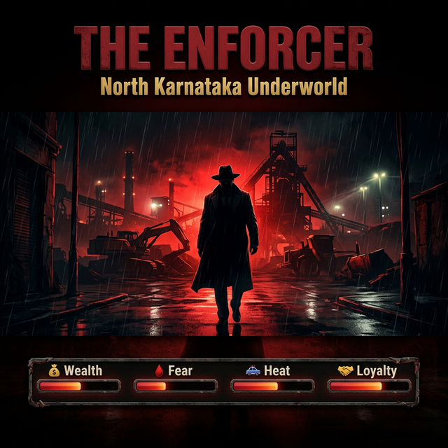
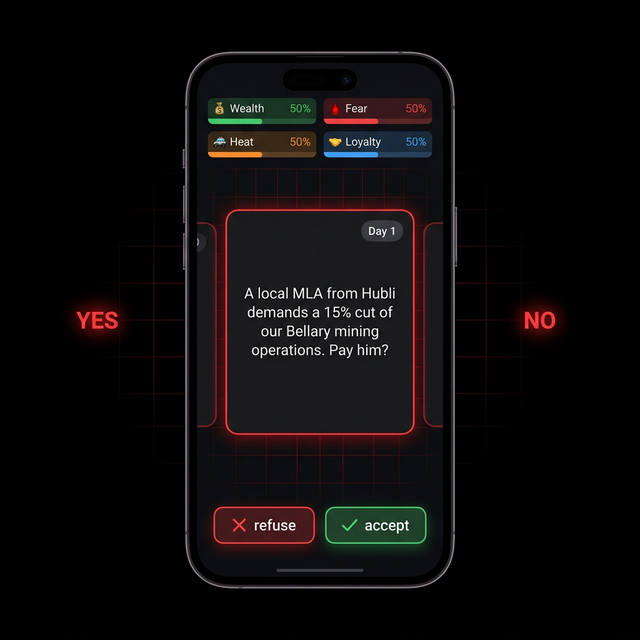
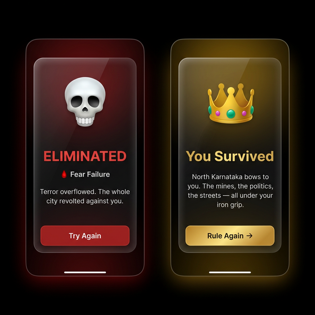

<p align="center">
  
</p>

<h1 align="center">🔴 THE ENFORCER</h1>
<p align="center"><em>A dark, swipe-driven underworld survival game set in the mines, politics, and streets of North Karnataka.</em></p>

<p align="center">
  
  
  
  
  
  
</p>

---

## 🎮 About the Game

**The Enforcer** is a mobile-first, swipe-card decision game inspired by _Reigns_, set in the gritty underworld of **North Karnataka** — a land of iron mines, political corruption, rival dons, and powder-keg loyalties.

You play as the **Don**. Every card is a decision. Every swipe has consequences.

> _"Balance is power."_

Survive 15 days as the most feared man in the region — without letting any of your four power meters tip to zero or overflow.

---

## 📸 Screenshots

<p align="center">
  
</p>
<p align="center"><sub>⬅️ Swipe LEFT to Refuse &nbsp;|&nbsp; Swipe RIGHT to Accept ➡️</sub></p>

<br />

<p align="center">
  
</p>
<p align="center"><sub>💀 Eliminated — or — 👑 Survive all 15 days and become the undisputed ruler</sub></p>

---

## ⚖️ The Four Power Meters

Every decision you make shifts these four stats. Let any one hit **0** or **100** — and you're done.

| Meter       | Icon | Too Low                                           | Too High                                        |
| ----------- | ---- | ------------------------------------------------- | ----------------------------------------------- |
| **Wealth**  | 💰   | _Bankrupt. The gang abandoned you._               | _Too rich — a rival cartel had you killed._     |
| **Fear**    | 🩸   | _Nobody fears you. A rival walked in._            | _Terror overflowed. The city revolted._         |
| **Heat**    | 🚓   | _Police got comfortable. They raided everything._ | _Military called in. You're in a black site._   |
| **Loyalty** | 🤝   | _Lieutenants mutinied. Assassinated at dinner._   | _Men got sloppy. A rival caught you off guard._ |

---

## 🃏 Scenarios

15 handcrafted scenarios rooted in real North Karnataka underworld culture — from **Bellary mining bribes** and **Hubli MLAs** to **rival dons from Koppal**, **bomb-making lieutenants**, and **Dasara donations**. Every playthrough is shuffled for a fresh experience.

Sample scenarios:

- _"A local MLA from Hubli demands a 15% cut of our Bellary mining operations. Pay him?"_
- _"Rival don Shankar Gouda from Koppal is moving iron ore trucks through our territory. Let them pass... for a toll?"_
- _"A corrupt municipality officer wants a fixed monthly payoff to look away from your stone quarry."_
- _"The festival of Dasara is here. The locals expect your 'donation' for the celebrations."_

---

## 🛠️ Tech Stack

| Technology           | Role                         |
| -------------------- | ---------------------------- |
| **Next.js 16**       | App framework (App Router)   |
| **React 19**         | UI rendering                 |
| **TypeScript 5**     | Type safety                  |
| **Tailwind CSS 4**   | Utility-first styling        |
| **Framer Motion 12** | Swipe gestures & animations  |
| **Zustand 5**        | Global game state management |
| **Capacitor 8**      | Android / iOS native wrapper |

---

## 🚀 Getting Started

### Prerequisites

- Node.js 18+
- npm or yarn

### Installation

```bash
# Clone the repository
git clone https://github.com/prashant13-bh/The-Enforcer.git
cd The-Enforcer

# Install dependencies
npm install

# Run the development server
npm run dev
```

Open [http://localhost:3000](http://localhost:3000) in your browser.

### Build for Production

```bash
npm run build
npm start
```

### Build for Android (Capacitor)

```bash
npm run build
npx cap sync android
npx cap open android
```

---

## 📁 Project Structure

```
The-Enforcer/
├── src/
│   ├── app/
│   │   ├── layout.tsx        # Root layout
│   │   ├── page.tsx          # Main game screen
│   │   └── globals.css       # Global styles
│   ├── components/
│   │   ├── SwipeCard.tsx     # Draggable scenario card with gestures
│   │   ├── TopBar.tsx        # Stat meters (Wealth, Fear, Heat, Loyalty)
│   │   └── GameOverlay.tsx   # Game Over / Victory modal
│   ├── store/
│   │   └── useGameStore.ts   # Zustand state — stats, swipe logic, game phase
│   └── data/
│       └── scenarios.json    # 15 North Karnataka underworld scenarios
├── public/                   # Static assets
├── capacitor.config.ts       # Capacitor mobile config
└── next.config.ts            # Next.js config
```

---

## 🎮 How to Play

1. **Read the scenario** on the card
2. **Swipe RIGHT** (or tap ✓) to **Accept** the deal
3. **Swipe LEFT** (or tap ✗) to **Refuse**
4. **Watch your meters** — keep all four balanced between 1–99
5. **Survive all 15 days** to win — or be eliminated

---

## 🏆 Win Conditions

| Result            | Condition                                             |
| ----------------- | ----------------------------------------------------- |
| 👑 **Victory**    | Survive all 15 decision cards with all stats in range |
| 💀 **Eliminated** | Any stat reaches 0 or 100                             |

---

## 📄 License

MIT License — feel free to fork, remix, and build your own underworld.

---

<p align="center">Made with 🩸 and ambition · North Karnataka Underworld · 2025</p>
